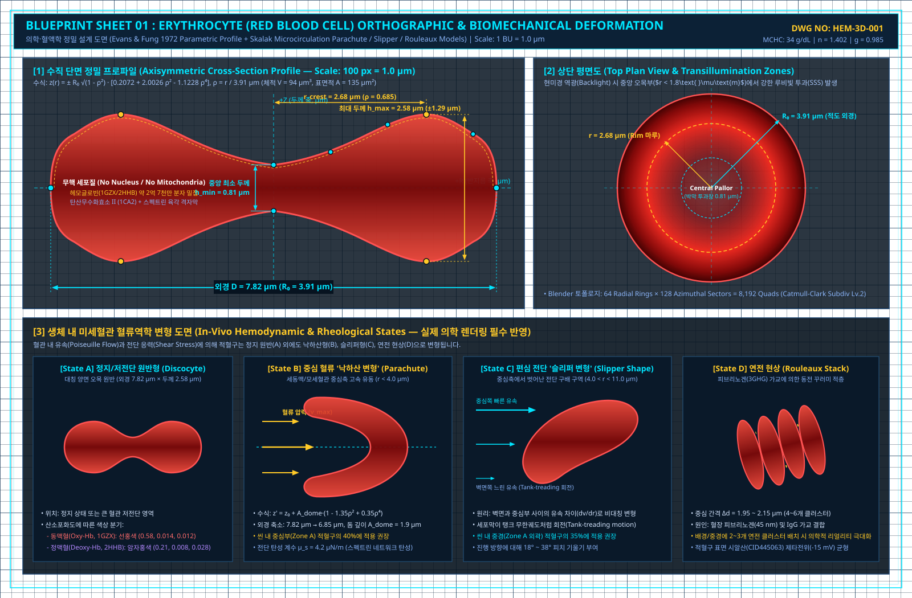
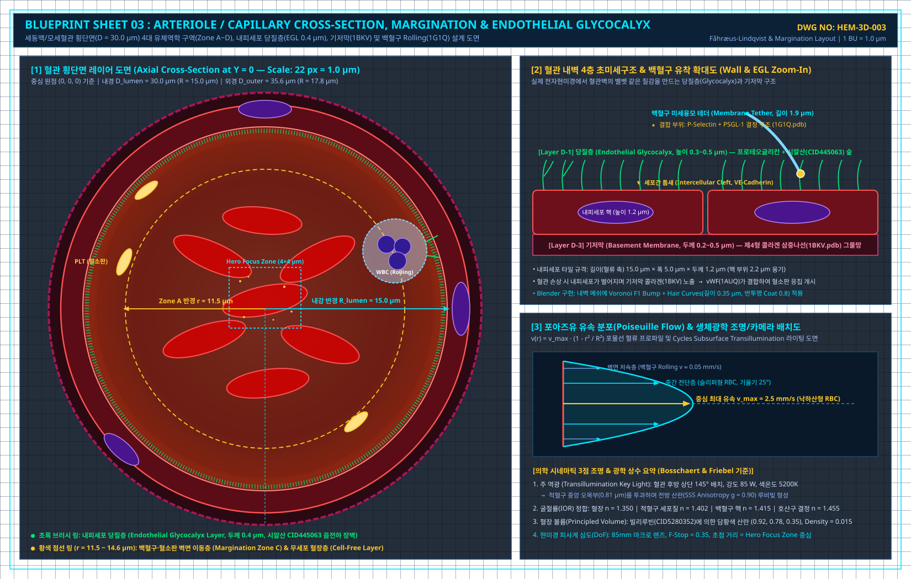

# 블렌더(Blender) 혈액 3D 정밀 설계 도면 및 수치 데이터 시트 (Codex 제작용 Blueprint)

이 문서는 **Codex가 Blender Python API (`bpy`, `bmesh`, `mathutils`)로 즉각 모델링 코드를 작성**할 수 있도록 모든 구성 요소의 **실제 물리 치수, 단면 프로파일 좌표 테이블, 분자 원자 3D 좌표($x, y, z$), 내부 핵/소기관 배치 좌표, Blender 4.x Principled BSDF 수치**를 도면 형태로 정리한 엔지니어링 명세서입니다.

> **시각 도면 & 의학 전자현미경 레퍼런스 통합 뷰어 안내**:
> - 전체 CAD 도면(4종)과 실제 의학 주사/투과전자현미경(SEM/TEM) 사진(17종)을 한눈에 볼 수 있는 **[`VISUAL_BLUEPRINT_GALLERY.html`](./VISUAL_BLUEPRINT_GALLERY.html)** 및 심화 의학 물리 레퍼런스 **[`MEDICAL_REALISM_REFERENCE.md`](./MEDICAL_REALISM_REFERENCE.md)**가 함께 구성되어 있습니다.

---

## 0. 시각 설계 도면 (CAD Blueprints) & 실제 의학 현미경(SEM/TEM) 프리뷰

### [CAD 도면 01] 적혈구 정투영 단면도 (Evans & Fung) 및 미세혈관 혈류 변형 (낙하산·슬리퍼·연전 현상)


### [CAD 도면 02] 백혈구 5종 (호중구·호산구·호염기구·림프구·단핵구) 및 혈소판 초미세구조 도면


### [CAD 도면 03] 세동맥/모세혈관 횡단면 ($D=30\text{ }\mu\text{m}$), 내피세포 당질층(Glycocalyx) 및 혈류 구획도


### [CAD 도면 04] 혈장 거대 단백질 (PDB 14종) 및 저분자 영양소·노폐물·기체 (SDF 23종) 마스터 도면


### [의학 전자현미경(SEM/TEM) 핵심 레퍼런스 사진 (`reference_images/`)]
| 적혈구·혈소판·백혈구 실제 SEM 비교 | 정상 적혈구 오목 원반 SEM | 모세혈관 내 적혈구 낙하산 변형 TEM |
| :---: | :---: | :---: |
|  |  |  |
| **백혈구 5종 핵/과립 해부학 도해** | **호산구 특수과립 결정 코어 TEM** | **피브린 그물망 & 적혈구 응고 SEM** |
|  |  |  |

---

## 0.1 블렌더 마스터 스케일 & 단위 규격 (Master Unit Setup)

실제 크기를 왜곡 없이 반영하기 위해 **2단계 기준 스케일(Dual-Scale Scene)** 또는 **단일 절대 스케일($1\text{ BU} = 1\text{ }\mu\text{m}$)**을 사용합니다.

- **기준 단위**: `1 Blender Unit (1 m in Blender) = 1 μm (10⁻⁶ m)`
- **나노미터(nm) 변환**: `1 nm = 0.001 BU` (`10⁻³ BU`)
- **옹스트롬(Å) 변환**: `1 Å = 0.0001 BU` (`10⁻⁴ BU`)
- **Blender Viewport/Camera Clipping 설정 (필수)**:
  - `clip_start = 0.00001` ($0.01\text{ nm}$ 분자까지 클리핑 없이 표시)
  - `clip_end = 1000.0` ($1,000\text{ }\mu\text{m}$ 혈관 전체 표시)

---

## 1. 혈구(Formed Elements) 정밀 기하학 도면 (Geometry Blueprints)

### 1.1 적혈구 (Red Blood Cell / Erythrocyte) 단면 및 치수 도면

#### [도면 1-1] 적혈구 수직 단면도 (Cross-Section Profile, 축대칭 회전체)
```text
                  Z (두께 축, μm)
                  ▲
      +1.29 μm ───┼──────╭───────────╮                 ╭───────────╮
                  │    ╭─╯           ╰──╮           ╭──╯           ╰─╮
      +0.405 μm ──┼───╱                  ╰─────────╯                  ╲
         0.0 μm ──┼──▕────────────────────────┼────────────────────────▏──► R (반지름 축, μm)
      -0.405 μm ──┼───╲                  ╭─────────╮                  ╱
                  │    ╰─╮           ╭──╯           ╰──╮           ╭─╯
      -1.29 μm ───┼──────╰───────────╯                 ╰───────────╯
                  │
                  ├───┼──────┼───────────┼─────────┼───────────┼──────┼───┤
                -3.91 -3.50 -2.68       0.0      +2.68       +3.50  +3.91 (μm)
```

#### [수식 및 정점 샘플링 테이블] (Evans & Fung Parametric Profile)
- **수식**: 반지름 $r \in [0, 3.91]\text{ }\mu\text{m}$, 정규화 반지름 $\rho = r / 3.91$
  $$z(r) = \pm 3.91 \sqrt{1 - \rho^2} \left( 0.2072 + 2.0026\rho^2 - 1.1228\rho^4 \right)$$
- **물리적 특성치**:
  - **외경 ($D$)**: $7.82\text{ }\mu\text{m}$ (반지름 $R_0 = 3.91\text{ }\mu\text{m}$)
  - **중앙 최소 두께 ($h_{\min}$)**: $0.81\text{ }\mu\text{m}$ ($r = 0.0\text{ }\mu\text{m}$에서 $z = \pm 0.405\text{ }\mu\text{m}$)
  - **림(Rim) 최대 두께 ($h_{\max}$)**: $2.58\text{ }\mu\text{m}$ ($r = 2.68\text{ }\mu\text{m}$에서 $z = \pm 1.290\text{ }\mu\text{m}$)
  - **표면적 ($A$)**: $135\text{ }\mu\text{m}^2$ / **부피 ($V$)**: $94\text{ }\mu\text{m}^3$

| 구간 인덱스 | 반지름 $r$ ($\mu\text{m}$) | 정규화 $\rho = r/R_0$ | 상단 $z^+$ ($\mu\text{m}$) | 하단 $z^-$ ($\mu\text{m}$) | 부위 설명 |
| :---: | :---: | :---: | :---: | :---: | :--- |
| 0 | `0.000` | `0.000` | `+0.405` | `-0.405` | 중앙 오목부 정점 (Dimple Center) |
| 1 | `0.500` | `0.128` | `+0.465` | `-0.465` | 오목부 완만한 경사 시작 |
| 2 | `1.000` | `0.256` | `+0.631` | `-0.631` | 오목부 → 림 변곡 구간 |
| 3 | `1.500` | `0.384` | `+0.869` | `-0.869` | 림 상승 구간 |
| 4 | `2.000` | `0.512` | `+1.113` | `-1.113` | 림 상단부 |
| 5 | `2.680` | `0.685` | `+1.290` | `-1.290` | **최대 두께 마루 (Rim Crest Peak)** |
| 6 | `3.100` | `0.793` | `+1.217` | `-1.217` | 외곽 라운딩 하강 시작 |
| 7 | `3.500` | `0.895` | `+0.946` | `-0.946` | 외곽 엣지 곡면 |
| 8 | `3.800` | `0.972` | `+0.503` | `-0.503` | 적도면 근접부 |
| 9 | `3.910` | `1.000` | `0.000` | `0.000` | **최외곽 적도 끝점 (Equator Edge)** |

> **Codex 구현 지침 (`bpy`)**: 위 $(r, z)$ 프로파일을 64개 구간으로 샘플링한 뒤 `bmesh.ops.spin(angle=2*math.pi, steps=128, axis=(0,0,1))`으로 회전시켜 쿼드(Quad) 토폴로지 메쉬를 생성하십시오.

---

### 1.2 백혈구 5종 (Leukocytes) 외막·핵·과립 3D 배치 도면

백혈구는 **외부 세포막(Outer Membrane) + 내부 핵(Inner Nucleus) + 세포질 과립(Cytoplasmic Granules)**의 3중 중첩 메쉬로 설계합니다.

#### [도면 1-2] 백혈구 5종 내부 핵(Nucleus) 기하 구조 및 좌표 명세

```text
  [1. 호중구 Neutrophil]       [2. 호산구 Eosinophil]       [3. 호염기구 Basophil]
   (3~4분엽 염주형 핵)            (안경 모양 2분엽핵)           (S자형 굵은 핵 + 거대과립)
       ╭───╮                        ╭─────╮   ╭─────╮              ╭─────────╮
     ╭─╯ L2╰─╮                    ╭─╯     ╰───╯     ╰─╮            ╰────╮    │
   ╭─╯ ╭───╮ ╰─╮                  │  Lobe1     Lobe2  │                 │    ╰────╮
   │L1 │   │ L3│                  ╰───────╮   ╭───────╯                 ╰─────────╯
   ╰───╯   ╰───╯                          ╰───╯

  [4. 림프구 Lymphocyte]       [5. 단핵구 Monocyte]
   (세포 85% 차지 거대 구형핵)    (말굽/강낭콩 모양 거대핵)
       ╭───────────╮                ╭───────────────╮
     ╭─╯           ╰─╮            ╭─╯     ╭───╮     ╰─╮
     │   거대 구형핵  │            │      ╭╯   ╰╮      │
     │    (보조개)   ╭╯            ╰──────╯     ╰──────╯
     ╰───────────────╯
```

#### 백혈구 5종 정밀 치수 및 내부 좌표 테이블 (중심 원점 `(0, 0, 0)` 기준, 단위: $\mu\text{m}$)

| 백혈구 종류 | 외막 반지름 ($R_{\text{cell}}$) | 미세융모(Ruffles) 돌출 높이 / 주파수 | 내부 핵(Nucleus) 3D 모델링 좌표 및 형태 (`Metaball` 또는 `Bezier Curve`) | 세포질 과립 (Granules) 반지름 및 개수 |
| :--- | :---: | :--- | :--- | :--- |
| **1. 호중구 (Neutrophil)**<br/>직경 $12.0\text{ }\mu\text{m}$ | `6.00` | 높이 `0.35 μm`<br/>Voronoi Scale `18.0` | **4분엽 메타볼(Metaballs) + 연결 필라멘트(두께 `0.25 μm`)**:<br/>- Lobe 1: `(-2.2, -1.5, 0.5)`, $r = 1.65$<br/>- Lobe 2: `(-0.8, 2.0, 1.0)`, $r = 1.55$<br/>- Lobe 3: `(1.8, 1.6, -0.6)`, $r = 1.60$<br/>- Lobe 4: `(2.1, -1.8, -0.4)`, $r = 1.50$ | 반지름 `0.10 ~ 0.15 μm`<br/>개수: `250 ~ 400개` (미세 입자) |
| **2. 호산구 (Eosinophil)**<br/>직경 $11.5\text{ }\mu\text{m}$ | `5.75` | 높이 `0.30 μm`<br/>Voronoi Scale `16.0` | **2분엽(Bilobed) 메타볼 + 아치형 연결교(두께 `0.45 μm`)**:<br/>- Lobe 1: `(-2.1, 0.0, 0.0)`, $r = 2.10$<br/>- Lobe 2: `(+2.1, 0.0, 0.0)`, $r = 2.10$<br/>- Bridge: `(0.0, 1.2, 0.5)`, $r = 0.65$ | 반지름 `0.25 ~ 0.35 μm` (굵은 회전타원체)<br/>개수: `180 ~ 250개` (빽빽함) |
| **3. 호염기구 (Basophil)**<br/>직경 $10.0\text{ }\mu\text{m}$ | `5.00` | 높이 `0.25 μm`<br/>Voronoi Scale `14.0` | **S자형 베지어 스플라인 튜브 (Radius `1.45 μm`)**:<br/>- P0: `(-2.2, -1.8, -0.5)`<br/>- P1: `(-1.0, 1.5, 0.0)`<br/>- P2: `(1.0, -1.5, 0.0)`<br/>- P3: `(2.2, 1.8, 0.5)` | 반지름 `0.30 ~ 0.50 μm` (매우 굵음)<br/>개수: `80 ~ 120개` (핵 주변을 덮음) |
| **4. 림프구 (Lymphocyte)**<br/>직경 $8.5\text{ }\mu\text{m}$ | `4.25` | 높이 `0.20 μm`<br/>Voronoi Scale `22.0` | **단일 거대 구형 핵 (한쪽 오목 보조개)**:<br/>- Main Sphere: `(0.15, 0.0, 0.0)`, $r = 3.55$<br/>- Boolean/Displace 덴트(오목부): `(-2.8, 0.0, 0.0)`, $r = 1.60$ | 과립 거의 없음 (리보솜 미세 입자 `0.05 μm` 소수) |
| **5. 단핵구 (Monocyte)**<br/>직경 $17.0\text{ }\mu\text{m}$ (최대) | `8.50` | 높이 `0.55 μm`<br/>주름진 박막 (Lamellipodia) | **강낭콩/말굽형(Kidney-shaped) 베지어 볼륨 (Radius `2.60 μm`)**:<br/>- P0: `(-3.5, -2.5, 0.0)`<br/>- P1: `(-3.8, 2.8, 0.5)`<br/>- P2: `(0.0, 4.2, 0.0)`<br/>- P3: `(3.8, 2.8, -0.5)`<br/>- P4: `(3.5, -2.5, 0.0)` | 반지름 `0.08 ~ 0.12 μm` (리소좀 미세 과립)<br/>개수: `300개` + 식포(Vacuole, $r=0.6$) $5 \sim 8$개 |

---

### 1.3 혈소판 (Platelets / Thrombocytes) 2종 상태 도면

#### [도면 1-3] 비활성(Resting) vs 활성(Activated) 혈소판 기하 명세
```text
   [비활성 혈소판 (Resting Discoid)]          [활성 혈소판 (Activated Spiny Sphere)]
          Z (+0.35 μm)                                   ╲       ▲       ╱
              ╭───╮                                       ╲    ╭───╮    ╱
         ╭────╯   ╰────╮                            ────── ╭───╯   ╰───╮ ──────
    ─────┤  양면 볼록  ├─────► R (1.25 μm)                 │  중심체   │  (위족 6~10개 방사형 돌출)
         ╰────╮   ╭────╯                            ────── ╰───╮   ╭───╯ ──────
              ╰───╯                                       ╱    ╰───╯    ╲
          Z (-0.35 μm)                                   ╱       ▼       ╲
                                                      (위족 끝단까지 반경 3.5 μm)
```

1. **비활성 혈소판 (Resting State)**:
   - **수식 (양면 볼록 타원체, Oblate Spheroid)**:
     $$\frac{x^2 + y^2}{1.25^2} + \frac{z^2}{0.35^2} = 1$$
   - **치수**: 직경 $2.50\text{ }\mu\text{m}$ ($R_{xy} = 1.25\text{ }\mu\text{m}$), 두께 $0.70\text{ }\mu\text{m}$ ($R_z = 0.35\text{ }\mu\text{m}$).
   - **표면 디테일**: 개방소관계(Open Canalicular System) 표현을 위해 표면에 직경 $0.08\text{ }\mu\text{m}$의 미세 홈(Pore) 15~20개 분포.
2. **활성 혈소판 (Activated State)**:
   - **중심 본체**: 반지름 $0.90\text{ }\mu\text{m}$의 불규칙 구형.
   - **위족 (Filopodia / Spikes)**: 중심 `(0,0,0)`에서 정십이면체(Icosahedron) 꼭짓점 방향 중 8~12개 방향으로 뻗어 나가는 곡선 원뿔(Tapered Bezier Tube).
     - 시작 반지름: `0.18 μm` $\to$ 끝단 반지름: `0.03 μm`
     - 위족 길이: `1.80 ~ 2.80 μm` (전체 외경 약 $5.0 \sim 6.5\text{ }\mu\text{m}$)

---

## 2. 혈장(Plasma) 내 수분·영양소·노폐물·단백질 정밀 분자 도면

혈장 속 분자들은 **실제 화학 결정학 데이터(Crystallography & Van der Waals 반지름)**를 기반으로 한 원자 3D 좌표 도면입니다.

### 2.1 원자별 표준 반데르발스 반지름 및 CPK 컬러 규격 (공통 참조표)

| 원소 기호 | 원자명 | 반데르발스 반지름 ($R_{\text{vdW}}$) | 단위 변환 (`1 Å = 0.1 nm`) | 표준 CPK Hex Color | RGB (Linear 0~1) |
| :---: | :--- | :---: | :---: | :---: | :--- |
| **H** | 수소 (Hydrogen) | `1.20 Å` | `0.120 nm` | `#FFFFFF` (순백색) | `(1.000, 1.000, 1.000)` |
| **C** | 탄소 (Carbon) | `1.70 Å` | `0.170 nm` | `#333333` (짙은 무연탄색) | `(0.033, 0.033, 0.033)` |
| **N** | 질소 (Nitrogen) | `1.55 Å` | `0.155 nm` | `#3050F8` (코발트 블루) | `(0.028, 0.078, 0.930)` |
| **O** | 산소 (Oxygen) | `1.52 Å` | `0.152 nm` | `#FF0D0D` (크림슨 레드) | `(1.000, 0.004, 0.004)` |
| **P** | 인 (Phosphorus) | `1.80 Å` | `0.180 nm` | `#FF8000` (오렌지) | `(1.000, 0.216, 0.000)` |
| **S** | 황 (Sulfur) | `1.80 Å` | `0.180 nm` | `#FFFF30` (설퍼 옐로우) | `(1.000, 1.000, 0.028)` |
| **Na⁺** | 나트륨 이온 | `1.16 Å` (수화 시 `3.58 Å`) | `0.116 nm` | `#AB5CF2` (보라색) | `(0.402, 0.107, 0.888)` |
| **K⁺** | 칼륨 이온 | `1.52 Å` (수화 시 `3.31 Å`) | `0.152 nm` | `#8F40D4` (심자색) | `(0.275, 0.051, 0.651)` |
| **Ca²⁺** | 칼슘 이온 | `1.14 Å` (수화 시 `4.12 Å`) | `0.114 nm` | `#3DFF00` (네온 그린) | `(0.047, 1.000, 0.000)` |
| **Cl⁻** | 염화 이온 | `1.67 Å` (수화 시 `3.32 Å`) | `0.167 nm` | `#1FF01F` (에메랄드 그린) | `(0.014, 0.871, 0.014)` |

---

### 2.2 [수분] 물 분자 ($\text{H}_2\text{O}$) 3D 원자 좌표 도면
- **물리 규격**: $\text{O}-\text{H}$ 공유결합 길이 $0.9572\text{ \AA}$ ($0.09572\text{ nm}$), $\angle\text{HOH}$ 결합각 $104.52^\circ$, 전체 외경 약 $2.75\text{ \AA}$ ($0.275\text{ nm}$).

```text
            Z (Å)
            ▲
            │      O1 (0.000, 0.000, +0.117) [R = 1.52 Å]
            │     ╱  ╲
            │    ╱    ╲  결합 길이 = 0.957 Å, 결합각 = 104.52°
            ├───╱──────╲───► X (Å)
               H1      H2
  (-0.757, 0, -0.469)  (+0.757, 0, -0.469) [R = 1.20 Å]
```

| 원자 ID | 원소 | $X$ ($\text{\AA}$) | $Y$ ($\text{\AA}$) | $Z$ ($\text{\AA}$) | 반지름 $R_{\text{vdW}}$ ($\text{\AA}$) | 결합 연결 (Bonds) |
| :---: | :---: | :---: | :---: | :---: | :---: | :--- |
| `O1` | O | `0.000` | `0.000` | `+0.117` | `1.52` | `O1-H1`, `O1-H2` |
| `H1` | H | `-0.757` | `0.000` | `-0.469` | `1.20` | `O1-H1` |
| `H2` | H | `+0.757` | `0.000` | `-0.469` | `1.20` | `O1-H2` |

---

### 2.3 [영양소 1] 포도당 ($\alpha$-D-Glucose, $\text{C}_6\text{H}_{12}\text{O}_6$) 3D 원자 좌표 도면
- **형태**: 피라노스 6원자 고리(탄소 5개 + 산소 1개)가 **의자형(Chair Conformation)**으로 꺾인 입체 구조. 전체 외경 약 $8.6\text{ \AA}$ ($0.86\text{ nm}$).

```text
          O6(-OH)
           │
          C6
           │
      C4──C5────O5 (고리 내 산소)
     ╱          ╲
   C3───────────C1
   │            │
  O3(-OH)      O1(-OH)
```

#### 포도당 핵심 무거운 원자(Heavy Atoms: C, O 12개) 3D 결정 좌표 (단위: $\text{\AA}$, PubChem CID 5793 기준)

| 원자 ID | 원소 | 역할 | $X$ ($\text{\AA}$) | $Y$ ($\text{\AA}$) | $Z$ ($\text{\AA}$) | 결합 연결 (Bonds) |
| :---: | :---: | :--- | :---: | :---: | :---: | :--- |
| `C1` | C | 고리 탄소 1 (Anomeric) | `+1.458` | `-0.412` | `-0.245` | `C1-C2`, `C1-O5`, `C1-O1` |
| `C2` | C | 고리 탄소 2 | `+0.712` | `-1.485` | `+0.532` | `C2-C1`, `C2-C3`, `C2-O2` |
| `C3` | C | 고리 탄소 3 | `-0.768` | `-1.124` | `+0.685` | `C3-C2`, `C3-C4`, `C3-O3` |
| `C4` | C | 고리 탄소 4 | `-1.415` | `-0.782` | `-0.654` | `C4-C3`, `C4-C5`, `C4-O4` |
| `C5` | C | 고리 탄소 5 | `-0.582` | `+0.325` | `-1.312` | `C5-C4`, `C5-O5`, `C5-C6` |
| `O5` | O | **피라노스 고리 산소** | `+0.785` | `-0.085` | `-1.452` | `O5-C5`, `O5-C1` |
| `C6` | C | 고리 밖 곁사슬 탄소 (`-CH2OH`) | `-1.142` | `+0.715` | `-2.675` | `C6-C5`, `C6-O6` |
| `O1` | O | 하이드록실기 산소 1 | `+2.785` | `-0.812` | `-0.512` | `O1-C1` (+ `H` 결합) |
| `O2` | O | 하이드록실기 산소 2 | `+1.312` | `-1.695` | `+1.805` | `O2-C2` (+ `H` 결합) |
| `O3` | O | 하이드록실기 산소 3 | `-1.452` | `-2.215` | `+1.285` | `O3-C3` (+ `H` 결합) |
| `O4` | O | 하이드록실기 산소 4 | `-2.765` | `-0.385` | `-0.452` | `O4-C4` (+ `H` 결합) |
| `O6` | O | 하이드록실기 산소 6 | `-0.352` | `+1.745` | `-3.245` | `O6-C6` (+ `H` 결합) |

*(수소 12개는 각 탄소 및 산소의 사면체 외곽 방향으로 $1.09\text{ \AA}$(C-H) 및 $0.96\text{ \AA}$(O-H) 거리에 배치)*

---

### 2.4 [영양소 2] 아미노산 (L-Alanine 기준, $\text{C}_3\text{H}_7\text{NO}_2$) 3D 원자 좌표 도면
- **형태**: 중심 알파 탄소($\text{C}_\alpha$)를 기준으로 아미노기($-\text{NH}_3^+$), 카복실기($-\text{COO}^-$), 메틸기($-\text{CH}_3$), 수소가 사면체로 결합된 양성이온(Zwitterion) 구조. 외경 약 $5.2\text{ \AA}$ ($0.52\text{ nm}$).

| 원자 ID | 원소 | 작용기 구분 | $X$ ($\text{\AA}$) | $Y$ ($\text{\AA}$) | $Z$ ($\text{\AA}$) | 결합 연결 |
| :---: | :---: | :--- | :---: | :---: | :---: | :--- |
| `CA` | C | 중심 알파 탄소 ($\text{C}_\alpha$) | `0.000` | `0.000` | `0.000` | `CA-C`, `CA-N`, `CA-CB` |
| `C` | C | 카복실기 탄소 | `+1.520` | `0.000` | `0.000` | `C-CA`, `C-O1`, `C-O2` |
| `O1` | O | 카복실기 산소 1 | `+2.150` | `+1.080` | `0.000` | `O1-C` |
| `O2` | O | 카복실기 산소 2 | `+2.080` | `-1.120` | `0.000` | `O2-C` |
| `N` | N | **아미노기 질소 (청색 강조)** | `-0.540` | `+1.360` | `0.000` | `N-CA` (+ `H` 3개) |
| `CB` | C | 곁사슬 메틸 탄소 ($-\text{CH}_3$) | `-0.510` | `-0.760` | `+1.230` | `CB-CA` (+ `H` 3개) |

---

### 2.5 [영양소 3] 지질 및 지단백질 (Lipids: 유리 지방산 & 미셀/지단백질 입자)
1. **유리 지방산 (팔미트산 Palmitic Acid, $\text{C}_{16}\text{H}_{32}\text{O}_2$, 길이 $2.1\text{ nm}$)**:
   - **머리(Head)**: 카복실기 탄소 `C1(0, 0, 0)`에 산소 `O1(0, +1.2, +0.6)`, `O2(0, -1.2, +0.6)`.
   - **꼬리(Tail)**: `C1`부터 `C16`까지 지그재그(All-trans 평면 사슬) 배치.
     - $n$번째 탄소 좌표 ($n = 1 \dots 16$):
       $$X_n = (n-1) \times 1.27\text{ \AA}, \quad Y_n = 0.0, \quad Z_n = \begin{cases} 0.0\text{ \AA} & (n\text{ 홀수}) \\ +0.88\text{ \AA} & (n\text{ 짝수}) \end{cases}$$
2. **지단백질 입자 (Lipoprotein / LDL·HDL 구형 미셀)**:
   - 외경 $20.0\text{ nm}$ ($0.02\text{ }\mu\text{m}$)의 구형 코어 + 표면에 반지름 $1.0\text{ nm}$ 인지질 머리(구체) 400개가 피보나치 구면 분포(Fibonacci Sphere Lattice)로 박혀 있고, 황금색 아포단백질(Apolipoprotein) 띠가 구 표면을 나선형으로 감싼 형태.

---

### 2.6 [노폐물 1] 요소 (Urea, $\text{CO(NH}_2)_2$) 3D 원자 좌표 도면
- **형태**: 간에서 암모니아로부터 합성되어 콩팥으로 배설되는 대표적 질소 노폐물. 완벽한 **평면 삼각형(Trigonal Planar, $Y=0$ 평면)** 대칭 구조. 외경 약 $4.8\text{ \AA}$ ($0.48\text{ nm}$).

```text
                O1 (0.000, 0.000, +1.260 Å) [적색]
                 ║  (C=O 이중결합 1.26 Å)
                 C1 (0.000, 0.000, 0.000 Å) [회색]
               ╱    ╲
   (1.35 Å)  ╱        ╲  (1.35 Å, ∠N-C-N = 117°)
           N1          N2 [청색]
         (-1.15, -0.69) (+1.15, -0.69)
         ╱   ╲        ╱   ╲
       H1     H2    H3     H4 [백색]
```

| 원자 ID | 원소 | $X$ ($\text{\AA}$) | $Y$ ($\text{\AA}$) | $Z$ ($\text{\AA}$) | 반지름 $R_{\text{vdW}}$ ($\text{\AA}$) | 결합 연결 |
| :---: | :---: | :---: | :---: | :---: | :---: | :--- |
| `C1` | C | `0.000` | `0.000` | `0.000` | `1.70` | `C1=O1`, `C1-N1`, `C1-N2` |
| `O1` | O | `0.000` | `0.000` | `+1.260` | `1.52` | `O1=C1` |
| `N1` | N | `-1.152` | `0.000` | `-0.695` | `1.55` | `N1-C1`, `N1-H1`, `N1-H2` |
| `N2` | N | `+1.152` | `0.000` | `-0.695` | `1.55` | `N2-C1`, `N2-H3`, `N2-H4` |
| `H1` | H | `-1.152` | `0.000` | `-1.705` | `1.20` | `H1-N1` |
| `H2` | H | `-2.025` | `0.000` | `-0.190` | `1.20` | `H2-N1` |
| `H3` | H | `+1.152` | `0.000` | `-1.705` | `1.20` | `H3-N2` |
| `H4` | H | `+2.025` | `0.000` | `-0.190` | `1.20` | `H4-N2` |

---

### 2.7 [노폐물 2] 이산화탄소 ($\text{CO}_2$) 및 중탄산 이온 ($\text{HCO}_3^-$) 3D 원자 좌표 도면
세포 호흡 결과 생성되어 혈장을 통해 폐로 운반되는 기체/이온 노폐물입니다 (혈장 내 $\text{CO}_2$의 약 70~80%는 $\text{HCO}_3^-$ 형태로, 약 7~10%는 용존 $\text{CO}_2$ 형태로 이동).

1. **이산화탄소 ($\text{CO}_2$, 직선형 $180^\circ$, 외경 $4.6\text{ \AA}$)**:
   - `C1`: `(0.000, 0.000, 0.000)` ($R = 1.70\text{ \AA}$)
   - `O1`: `(-1.160, 0.000, 0.000)` ($R = 1.52\text{ \AA}$)
   - `O2`: `(+1.160, 0.000, 0.000)` ($R = 1.52\text{ \AA}$)
2. **중탄산 이온 ($\text{HCO}_3^-$, 평면 삼각형 $120^\circ$, 외경 $4.9\text{ \AA}$)**:
   - `C1`: `(0.000, 0.000, 0.000)`
   - `O1`: `(0.000, 0.000, +1.250)`
   - `O2`: `(-1.080, 0.000, -0.625)`
   - `O3`: `(+1.150, 0.000, -0.680)` (수소 `H1`이 `(+1.950, 0.000, -0.150)`에 결합)

---

### 2.8 [혈장 단백질 3종] 거대 분자 3D 기하 도면 (Albumin, Fibrinogen, IgG)

Blender에서 PDB 파일을 직접 임포트하지 않고도 프로시저럴하게 실제 형태를 100% 재현할 수 있는 **도메인(Domain) 구/캡슐 조합 도면**입니다 (단위: $\text{nm}$).

```text
  [1. 알부민 Albumin (8.0 nm)]     [2. 피브리노겐 Fibrinogen (45.0 nm)]       [3. 항체 IgG (14.5 nm)]
       하트 모양 3도메인 구상단백질         3절 결절 아령형 (Trinodular Rod)           Y자형 면역글로불린
         ╭───╮     ╭───╮              ╭───╮        ╭───╮        ╭───╮        ╭───╮       ╭───╮
        │ D1 │   │ D3 │             │ D │═══════│ E │═══════│ D │        ╲Fab╲     ╱Fab╱
         ╰─╮ ╰───╯ ╭─╯              ╰───╯  코일  ╰───╯  코일  ╰───╯          ╲   ╲ ╱   ╱
            ╰─┤ D2 ├─╯               (6.5nm)     (5.0nm)     (6.5nm)            │ Fc  │ (힌지 각도 110°)
              ╰────╯                 ├──────────── 45.0 nm ────────────┤            ╰─────╯
```

| 단백질 명칭 | 전체 크기 ($\text{nm}$) | 3D 프로시저럴 도면 좌표 (`Metaball` / `Capsule` 조합, 단위: $\text{nm}$) |
| :--- | :---: | :--- |
| **알부민 (Serum Albumin)**<br/>PDB: `1AO6` | $8.0 \times 8.0 \times 3.0\text{ nm}$ | **하트 모양(Heart-shaped) 3개 도메인 클러스터** (표면에 `Voronoi Bump` 적용):<br/>- Domain I (좌상단): `(-2.0, 0.0, +1.2)`, 반지름 $r = 2.1\text{ nm}$<br/>- Domain II (중앙하단 꼭짓점): `(0.0, 0.0, -1.5)`, 반지름 $r = 2.2\text{ nm}$<br/>- Domain III (우상단): `(+2.0, 0.0, +1.2)`, 반지름 $r = 2.1\text{ nm}$ |
| **피브리노겐 (Fibrinogen)**<br/>PDB: `3GHG` | 길이 $45.0\text{ nm}$<br/>직경 $5.0 \sim 6.5\text{ nm}$ | **아령형 3결절 막대 구조 (Trinodular Rod, 살짝 휜 곡선)**:<br/>- 중앙 E-Nodule: `(0.0, 0.0, 0.0)`, 타원체 반지름 `(2.5, 2.0, 2.0) nm`<br/>- 좌측 D-Nodule: `(-21.0, +1.5, 0.0)`, 타원체 반지름 `(3.5, 2.8, 2.8) nm`<br/>- 우측 D-Nodule: `(+21.0, +1.5, 0.0)`, 타원체 반지름 `(3.5, 2.8, 2.8) nm`<br/>- 연결 Coiled-coil Rod: 좌우 각각 반지름 $0.8\text{ nm}$의 3중 나선 실린더로 연결 |
| **면역글로불린 G (IgG 항체)**<br/>PDB: `1IGT` | $14.5 \times 12.0 \times 4.0\text{ nm}$ | **Y자형 3개 암(Arm) 구조 (중심 힌지 `(0,0,0)` 기준)**:<br/>- 하단 Fc 줄기: `(0.0, 0.0, -3.5)`, 캡슐 길이 $6.5\text{ nm}$, 반지름 $2.2\text{ nm}$<br/>- 좌상단 Fab 팔: 중심 `(-3.8, 0.0, +3.2)`, 축 회전 $+55^\circ$, 캡슐 길이 $7.0\text{ nm}$, 반지름 $2.0\text{ nm}$<br/>- 우상단 Fab 팔: 중심 `(+3.8, 0.0, +3.2)`, 축 회전 $-55^\circ$, 캡슐 길이 $7.0\text{ nm}$, 반지름 $2.0\text{ nm}$ |

---

## 3. 혈관 단면 및 공간 배치 도면 (Vessel & Spatial Layout Blueprint)

Codex가 씬(Scene)에 혈관과 혈구·혈장 분자들을 실제 혈류 역학(Margination & Poiseuille Flow)에 맞게 배치할 수 있는 공간 좌표 도면입니다.

### [도면 3-1] 세동맥/모세혈관 횡단면 레이어 구획도 (Vessel Cross-Section Zones)
- 권장 혈관 모델: 내경 $D_{\text{vessel}} = 30.0\text{ }\mu\text{m}$ (반지름 $R_{\text{vessel}} = 15.0\text{ }\mu\text{m}$), 길이 $L = 80.0\text{ }\mu\text{m}$의 원통형 실린더 (또는 완만한 S자형 베지어 커브 튜브).

```text
                      ╭───────────────────────────────╮
                  ╭───╯   혈관 내피세포 벽 (R = 15.0 μm) ╰───╮
               ╭──╯   [Zone C: 벽면 혈장층 & 백혈구/혈소판]    ╰──╮
             ╭─╯         (반경 11.5 ~ 14.5 μm 구간)            ╰─╮
            ╭╯         ╭─────────────────────────────╮          ╰╮
           ╭╯        ╭─╯  [Zone A: 적혈구 코어 혈류]   ╰─╮        ╰╮
           │         │       (반경 0.0 ~ 11.5 μm)       │         │
           │    PLT  │     RBC    RBC    RBC    RBC     │  WBC    │
           ╰╮        ╰─╮     RBC    RBC    RBC       ╭─╯ (Rolling)╭╯
            ╰╮         ╰─────────────────────────────╯          ╭╯
             ╰─╮      [Zone B: 혈장 나노 분자 (전 구역 분포)]    ╭─╯
               ╰──╮              ●  ◦  ∙  ◦  ●              ╭──╯
                  ╰───╮                                 ╭───╯
                      ╰───────────────────────────────╯
```

| 구역 (Zone) | 반경 범위 $r$ ($\mu\text{m}$) | 배치 대상 오브젝트 | 회전 및 정렬 규칙 |
| :--- | :---: | :--- | :--- |
| **Zone A (Core Flow)** | $0.0 \le r \le 11.5\text{ }\mu\text{m}$ | **적혈구 (RBC)** | 혈류 진행 축($Y$축)에 대해 $15^\circ \sim 45^\circ$ 비스듬히 기울어진 채 겹치지 않게 밀집 배치 (최소 중심 간격 $5.5\text{ }\mu\text{m}$) |
| **Zone C (Margination Layer)** | $11.0 \le r \le 14.2\text{ }\mu\text{m}$ | **백혈구 5종 (WBC)** 및 **혈소판 (Platelet)** | 내피세포 벽면을 따라 배치 (단핵구·호중구는 벽면에 근접하여 굴러가는 포즈) |
| **Zone B (Plasma Matrix)** | $0.0 \le r \le 14.8\text{ }\mu\text{m}$ (전 구역 + 카메라 근접 포커스 존) | **수분, 포도당, 아미노산, 지질, 알부민, 피브리노겐, 요소, $\text{CO}_2$, 이온** | 실제 나노 스케일($0.0003 \sim 0.045\text{ }\mu\text{m}$)은 카메라 초점 영역(Macro-to-Nano Hero Zone, 반경 $2.0\text{ }\mu\text{m}$ 박스)에 고밀도 파티클로 집중 배치하고, 동시에 교육용 확대 쇼케이스 레이어(Callout Magnifier Lens)를 함께 구성 가능 |
| **Zone D (Vessel Wall)** | $15.0 \le r \le 17.5\text{ }\mu\text{m}$ | **혈관 내피세포 (Endothelium)** | 내벽에 길이 $15\text{ }\mu\text{m}$, 폭 $5\text{ }\mu\text{m}$, 두께 $1.2\text{ }\mu\text{m}$의 조약돌형 다각형 셀 타일링 (`Voronoi F1` 디스플레이스먼트) |

---

## 4. Blender 4.x Principled BSDF & Shader 노드 수치 명세표 (Cycles 기준)

Codex가 `bpy.types.ShaderNodeBsdfPrincipled`에 그대로 입력할 수 있는 정확한 파라미터 테이블입니다.

| 대상 재질 (Material Name) | Base Color `(R, G, B)` (Linear) | Subsurface Weight | Subsurface Scale ($\mu\text{m}$) | Subsurface Radius `(R, G, B)` | Roughness | IOR | Transmission Weight | Coat Weight / Roughness | 추가 프로시저럴 노드 |
| :--- | :--- | :---: | :---: | :--- | :---: | :---: | :---: | :---: | :--- |
| `MAT_RBC_Arterial` (적혈구) | `(0.520, 0.012, 0.018)` | `0.85` | `0.60` | `(1.00, 0.22, 0.10)` | `0.28` | `1.400` | `0.05` | `0.40 / 0.15` | `Noise Texture(Scale=6)` $\to$ `Bump(Strength=0.04)` |
| `MAT_WBC_Membrane` (백혈구 외막) | `(0.820, 0.860, 0.900)` | `0.65` | `0.80` | `(0.85, 0.92, 1.00)` | `0.48` | `1.370` | `0.72` | `0.25 / 0.30` | `Layer Weight(Facing)`로 외곽 Fresnel 불투명도 강화 + `Voronoi` 변위 |
| `MAT_WBC_Nucleus` (백혈구 핵) | `(0.110, 0.035, 0.220)` | `0.50` | `0.40` | `(0.45, 0.15, 0.80)` | `0.55` | `1.420` | `0.10` | `0.00 / 0.00` | 염색질 질감을 위해 `Noise(Scale=25)` $\to$ `Bump(0.25)` |
| `MAT_Granule_Eosin` (호산구 과립) | `(0.850, 0.080, 0.040)` | `0.70` | `0.20` | `(1.00, 0.30, 0.10)` | `0.20` | `1.450` | `0.30` | `0.50 / 0.10` | 선홍빛 굴절 구체 |
| `MAT_Granule_Baso` (호염기구 과립) | `(0.030, 0.020, 0.180)` | `0.40` | `0.15` | `(0.15, 0.10, 0.60)` | `0.35` | `1.460` | `0.05` | `0.30 / 0.20` | 짙은 청자색 불투명 과립 |
| `MAT_Platelet` (혈소판) | `(0.780, 0.680, 0.480)` | `0.80` | `0.45` | `(1.00, 0.85, 0.55)` | `0.35` | `1.390` | `0.20` | `0.30 / 0.20` | `Voronoi(Scale=35)` $\to$ 미세 구멍(Pore) Bump |
| `MAT_Plasma_Volume` (혈장 유체) | Volume Scatter `(0.92, 0.78, 0.35)` | - | - | - | - | `1.335` | - | - | `Principled Volume`: `Density = 0.015`, `Anisotropy = 0.65`, `Absorption Color = (0.98, 0.90, 0.65)` |
| `MAT_Vessel_Wall` (혈관 내벽) | `(0.420, 0.035, 0.045)` | `0.90` | `1.20` | `(1.00, 0.25, 0.12)` | `0.32` | `1.380` | `0.00` | `0.80 / 0.10` | 점액질(Glycocalyx) 광택을 위해 높은 Coat 적용 |

---

## 5. 실제 과학 연구용 3D 분자·단백질 원본 데이터 (`molecular_data/`) 매니페스트 및 파싱 규격

작업 폴더 내 `molecular_data/` 디렉터리에 **RCSB PDB(단백질데이터뱅크)**와 **NCBI PubChem(국립생물공학정보센터)**에서 다운로드한 **실제 3D 결정 구조 및 3D Conformer 파일(`.pdb`, `.sdf`)**이 준비되어 있습니다. Codex는 아래 파일들을 `bpy` 파이썬 스크립트에서 직접 파싱하여 **100% 실제 원자 좌표 기반 3D 메쉬**를 생성해야 합니다.

### 5.1 거대 단백질 3D 구조 파일 (`molecular_data/pdb/*.pdb` — 총 14종)

| 파일 경로 | 명칭 및 생물학적 역할 | PDB ID | 원자 수 / 크기 | Codex(`bpy`) 모델링 권장 방식 |
| :--- | :--- | :---: | :--- | :--- |
| `molecular_data/pdb/1AO6_albumin.pdb` | **인간 혈청 알부민 (Human Serum Albumin)**<br/>혈장 삼투압 유지 및 지방산·수분·호르몬 운반 | `1AO6` | 약 $9,500$ 원자 ($\sim 8.0\text{ nm}$) | 알파탄소(`CA`) 백본 추출 후 `Metaball` 또는 `Geometry Nodes (Points to Volume -> Volume to Mesh, Radius=3.5Å)`로 매끄러운 구상 단백질 표면 생성 |
| `molecular_data/pdb/1E7I_albumin_palmitic_acid_complex.pdb` | **팔미트산 7분자 결합 알부민 (HSA + Palmitic Acid)**<br/>지방 소화 산물이 실제로 알부민에 결합해 운반되는 복합체 | `1E7I` | 약 $5,100$ 원자 ($\sim 8.0\text{ nm}$) | 단백질 표면 + `HETATM`의 `PLM`(팔미트산 사슬)을 녹색/황금색 구체로 강조 |
| `molecular_data/pdb/3GHG_fibrinogen.pdb` | **인간 피브리노겐 (Human Fibrinogen)**<br/>혈액 응고 단백질 (트롬빈에 의해 피브린 그물 형성) | `3GHG` | 약 $26,000$ 원자 (길이 $45.0\text{ nm}$) | `CA` 원자 좌표를 따라 3결절 막대(Trinodular rod) 볼륨 메쉬 생성 |
| `molecular_data/pdb/1PPB_thrombin_coagulation.pdb` | **인간 알파-트롬빈 ($\alpha$-Thrombin)**<br/>피브리노겐을 절단하여 피브린 그물망을 만드는 응고 효소 | `1PPB` | 약 $2,500$ 원자 ($\sim 4.5\text{ nm}$) | 활성 부위를 피브리노겐(`3GHG`) 중앙 E-도메인에 인접 배치 |
| `molecular_data/pdb/1IGT_immunoglobulin_IgG.pdb` | **면역글로불린 G (IgG 항체)**<br/>백혈구(림프구) 유래 혈장 면역 항체 | `1IGT` | 약 $10,200$ 원자 ($\sim 14.5\text{ nm}$) | Y자형 체인별(Heavy/Light Chain) 색상 분리 후 볼륨 표면 메쉬 생성 |
| `molecular_data/pdb/1GZX_oxyhemoglobin.pdb` | **산소 결합 인간 헤모글로빈 (Oxy-Hemoglobin, R-state)**<br/>동맥혈 적혈구 내부 산소 운반 $\alpha_2\beta_2$ 4량체 + 헴(Heme) | `1GZX` | 약 $4,700$ 원자 ($\sim 6.5\text{ nm}$) | 4개의 서브유닛(`Chain A, B, C, D`) 볼륨 메쉬 + `HETATM`의 `HEM`(헴 철 이온 및 포르피린 고리)과 `OXY`(산소 분자)를 발광 구체로 강조 |
| `molecular_data/pdb/2HHB_deoxyhemoglobin.pdb` | **탈산소 인간 헤모글로빈 (Deoxy-Hemoglobin, T-state)**<br/>조직에 산소를 해리한 정맥혈 적혈구 헤모글로빈 | `2HHB` / `4HHB` | 약 $4,700$ 원자 ($\sim 6.5\text{ nm}$) | `1GZX`와 비교 전시 및 정맥혈 적혈구 내부 배치 |
| `molecular_data/pdb/1CA2_carbonic_anhydrase_II.pdb` | **탄산무수화효소 II (Carbonic Anhydrase II)**<br/>적혈구 내부에서 $\text{CO}_2 \to \text{HCO}_3^-$ 전환을 촉매하는 효소 | `1CA2` | 약 $2,200$ 원자 ($\sim 5.0\text{ nm}$) | 적혈구 단면 내부에 배치하고 주변에 $\text{CO}_2$, $\text{H}_2\text{O}$, $\text{HCO}_3^-$ 분자 배치 |
| `molecular_data/pdb/1AFO_glycophorin_A_membrane.pdb` | **글리코포린 A (Glycophorin A 막관통 단백질)**<br/>적혈구 세포막 관통 및 외측 시알산 음전하 코트 형성 | `1AFO` | 막관통 $\alpha$-나선 이량체 | 적혈구 세포막 지질 이중층 클로즈업에 수직 관통 배치 |
| `molecular_data/pdb/1G1Q_P_selectin_PSGL1_rolling.pdb` | **P-셀렉틴 + PSGL-1 결합 복합체**<br/>백혈구가 혈관 내피세포 벽면에서 Rolling할 때 붙잡는 수용체 | `1G1Q` | 약 $5,600$ 원자 ($\sim 9.5\text{ nm}$) | 백혈구 미세융모 끝단과 혈관 내벽 사이에 가교 배치 |
| `molecular_data/pdb/1AUQ_vWF_A1_platelet_adhesion.pdb` | **폰 빌레브란트 인자 A1 도메인 (vWF)**<br/>혈관 손상 부위에 혈소판을 부착시키는 지혈 단백질 | `1AUQ` | 약 $1,900$ 원자 ($\sim 4.2\text{ nm}$) | 혈관 내벽 콜라겐(`1BKV`)과 활성 혈소판 위족 사이에 배치 |
| `molecular_data/pdb/1BKV_collagen_triple_helix.pdb` | **콜라겐 삼중 나선 섬유 (Collagen Triple Helix)**<br/>혈관 내피세포 하부 기저막 구조 단백질 | `1BKV` | 삼중 나선 막대 구조 | 혈관벽 외곽 기저막(Zone D 외측)에 그물망 형태로 반복 배치 |
| `molecular_data/pdb/1A8E_transferrin_iron_carrier.pdb` | **인간 혈청 트랜스페린 (Serum Transferrin)**<br/>혈장 내 철 이온($\text{Fe}^{3+}$) 수송 단백질 | `1A8E` | 약 $2,800$ 원자 ($\sim 7.0\text{ nm}$) | 혈장 단백질 쇼케이스에 알부민·IgG와 함께 배치 |
| `molecular_data/pdb/4INS_insulin_hormone.pdb` | **인간 인슐린 호르몬 (Human Insulin)**<br/>혈장을 통해 운반되어 혈당(포도당) 흡수를 조절하는 대표 호르몬 | `4INS` | 약 $1,600$ 원자 ($\sim 3.5\text{ nm}$) | 혈장 내 포도당(`CID5793`) 분자 군집 인근에 배치 |

#### [PDB 파일 파싱 규격 (Fixed-Width Column Format)]
- `ATOM` 또는 `HETATM`으로 시작하는 라인에서 추출 (단위: $\text{\AA}$, `1 Å = 0.0001 BU`):
  - `Record Type`: `line[0:6].strip()` (`"ATOM"` or `"HETATM"`)
  - `Atom Name`: `line[12:16].strip()` (단백질 저폴리곤 표면 생성 시 `"CA"` 필터링 가능)
  - `Residue Name`: `line[17:20].strip()` (`"HEM"`, `"OXY"` 등 식별)
  - `Chain ID`: `line[21].strip()`
  - `X, Y, Z 좌표 (Å)`: `float(line[30:38])`, `float(line[38:46])`, `float(line[46:54])`
  - `Element Symbol`: `line[76:78].strip()`

---

### 5.2 혈장 저분자 물질 (수분·영양소·노폐물·호흡기체) 3D 구조 파일 (`molecular_data/sdf/*.sdf`)

| 분류 | 파일 경로 | 물질명 (화학식) | PubChem CID | 생물학적 의의 (교과 핵심 개념) |
| :--- | :--- | :--- | :---: | :--- |
| **수분** | `molecular_data/sdf/water_H2O_CID962.sdf` | **물 ($\text{H}_2\text{O}$)** | `962` | 혈장의 90~92%를 차지하는 용매 및 물질 운반 매질 |
| **영양소** | `molecular_data/sdf/glucose_C6H12O6_CID5793.sdf` | **포도당 ($\text{C}_6\text{H}_{12}\text{O}_6$)** | `5793` | 탄수화물 소화 산물, 세포 호흡의 주 에너지원 |
| **영양소** | `molecular_data/sdf/alanine_amino_acid_CID5950.sdf` | **알라닌 ($\text{C}_3\text{H}_7\text{NO}_2$)** | `5950` | 단백질 소화 산물(아미노산 대표), 세포 구성 및 효소 원료 |
| **영양소** | `molecular_data/sdf/palmitic_fatty_acid_CID985.sdf` | **팔미트산 ($\text{C}_{16}\text{H}_{32}\text{O}_2$)** | `985` | 지방 소화 산물(지방산 대표), 알부민에 결합해 혈장 내 이동 |
| **영양소** | `molecular_data/sdf/glycerol_CID753.sdf` | **글리세롤 ($\text{C}_3\text{H}_8\text{O}_3$)** | `753` | 지방 소화 산물(모노글리세리드/글리세롤 성분) |
| **영양소** | `molecular_data/sdf/cholesterol_CID5997.sdf` | **콜레스테롤 ($\text{C}_{27}\text{H}_{46}\text{O}$)** | `5997` | 세포막 구성 성분 및 지단백질(LDL/HDL) 코어 지질 |
| **영양소** | `molecular_data/sdf/vitaminC_ascorbic_acid_CID54670067.sdf` | **비타민 C ($\text{C}_6\text{H}_8\text{O}_6$)** | `54670067` | 혈장에 용해되어 운반되는 수용성 비타민 대표 |
| **노폐물** | `molecular_data/sdf/urea_waste_CID1176.sdf` | **요소 ($\text{CO(NH}_2)_2$)** | `1176` | 단백질(아미노산) 대사 결과 간에서 합성되어 콩팥으로 운반되는 대표 노폐물 |
| **노폐물** | `molecular_data/sdf/carbon_dioxide_CO2_CID280.sdf` | **이산화탄소 ($\text{CO}_2$)** | `280` | 세포 호흡 결과 생성되어 혈장·적혈구를 통해 폐로 운반되는 기체 노폐물 |
| **노폐물** | `molecular_data/sdf/bicarbonate_HCO3_CID769.sdf` | **탄산수소 이온 ($\text{HCO}_3^-$)** | `769` | 혈장 내 이산화탄소($\text{CO}_2$)의 주요 이동 형태 (약 70~80%) |
| **노폐물** | `molecular_data/sdf/ammonia_NH3_CID222.sdf` | **암모니아 ($\text{NH}_3$)** | `222` | 아미노산 분해 시 발생하는 독성 질소 노폐물 (간에서 요소로 전환) |
| **노폐물** | `molecular_data/sdf/uric_acid_waste_CID1175.sdf` | **요산 ($\text{C}_5\text{H}_4\text{N}_4\text{O}_3$)** | `1175` | 핵산(퓨린) 대사 노폐물 |
| **노폐물** | `molecular_data/sdf/creatinine_waste_CID588.sdf` | **크레아티닌 ($\text{C}_4\text{H}_7\text{N}_3\text{O}$)** | `588` | 근육 크레아틴 대사 노폐물 (콩팥 여과 지표) |
| **색소/대사물** | `molecular_data/sdf/bilirubin_pigment_CID5280352.sdf` | **빌리루빈 ($\text{C}_{33}\text{H}_{36}\text{N}_4\text{O}_6$)** | `5280352` | 수명이 다한 적혈구(헤모글로빈 헴) 분해 산물, **혈장이 노란빛(담황색)을 띠게 하는 원인 색소** |
| **호흡기체** | `molecular_data/sdf/oxygen_O2_CID977.sdf` | **산소 기체 ($\text{O}_2$)** | `977` | 폐포에서 적혈구 헤모글로빈(`1GZX`)에 결합하여 조직 세포로 운반되는 호흡 기체 |
| **에너지/대사물** | `molecular_data/sdf/atp_energy_CID5957.sdf` | **ATP ($\text{C}_{10}\text{H}_{16}\text{N}_5\text{O}_{13}\text{P}_3$)** | `5957` | 세포 호흡 에너지 화폐, 혈소판 고밀도 과립 성분 및 혈관 확장 신호 물질 |
| **에너지/대사물** | `molecular_data/sdf/pyruvic_acid_CID1060.sdf` | **피루브산 ($\text{C}_3\text{H}_4\text{O}_3$)** | `1060` | 포도당 해당과정(Glycolysis) 대사 중간체 |
| **에너지/대사물** | `molecular_data/sdf/lactic_acid_lactate_CID612.sdf` | **젖산 / 락테이트 ($\text{C}_3\text{H}_6\text{O}_3$)** | `612` | 미토콘드리아가 없는 적혈구의 무산소 해당과정 산물 및 근육 운동 대사물 |
| **에너지/대사물** | `molecular_data/sdf/citric_acid_CID311.sdf` | **시트르산 ($\text{C}_6\text{H}_8\text{O}_7$)** | `311` | TCA 회로 유기산 및 혈장 내 칼슘($\text{Ca}^{2+}$) 완충 성분 |
| **호르몬** | `molecular_data/sdf/epinephrine_adrenaline_CID5816.sdf` | **에피네프린 / 아드레날린 ($\text{C}_9\text{H}_{13}\text{NO}_3$)** | `5816` | 부신속질에서 혈액으로 분비되어 심박수·혈류를 조절하는 대표 카테콜아민 호르몬 |
| **세포막/지질** | `molecular_data/sdf/phosphocholine_headgroup_CID65091.sdf` | **포스포콜린 ($\text{C}_5\text{H}_{15}\text{NO}_4\text{P}^+$)** | `65091` | 혈구 세포막 인지질 이중층 및 지단백질(LDL/HDL) 외피의 친수성 머리 작용기 |
| **당질층(EGL)** | `molecular_data/sdf/sialic_acid_Neu5Ac_glycocalyx_CID445063.sdf` | **시알산 / N-아세틸뉴라민산 ($\text{C}_{11}\text{H}_{19}\text{NO}_9$)** | `445063` | 혈관 내피세포 당질층(Glycocalyx)과 적혈구 표면 음전하 코트를 형성하는 핵심 당 분자 |
| **헴 고리** | `molecular_data/sdf/protoporphyrin_IX_heme_ring_CID4971.sdf` | **프로토포르피린 IX (Heme 고리)** | `4971` | 헤모글로빈 중심에서 철 이온($\text{Fe}^{2+}$)과 함께 산소를 결합하는 거대 포르피린 고리 |

#### [SDF (MOL V2000) 파일 파싱 규격]
- 4번째 줄(Counts Line, 인덱스 3): `num_atoms = int(line[0:3])`, `num_bonds = int(line[3:6])`
- **Atom Block** (`4`번째 줄부터 `num_atoms`개 줄):
  - `parts = line.split()`
  - `x, y, z = float(parts[0]), float(parts[1]), float(parts[2])` (단위: $\text{\AA}$)
  - `element = parts[3]` (`"C"`, `"O"`, `"N"`, `"H"` 등 $\to$ 섹션 2.1의 반데르발스 반지름 $R_{\text{vdW}}$ 및 CPK 색상 매핑)
- **Bond Block** (Atom Block 직후부터 `num_bonds`개 줄):
  - `atom1_idx = int(line[0:3]) - 1`, `atom2_idx = int(line[3:6]) - 1`, `bond_order = int(line[6:9])`
  - Ball-and-Stick 모드에서는 두 원자 중심을 잇는 실린더(반지름 $0.25\text{ \AA}$)를 생성하고, Space-Filling(CPK) 모드에서는 각 원자를 반데르발스 반지름($R_{\text{vdW}}$) 구체로 생성합니다.


