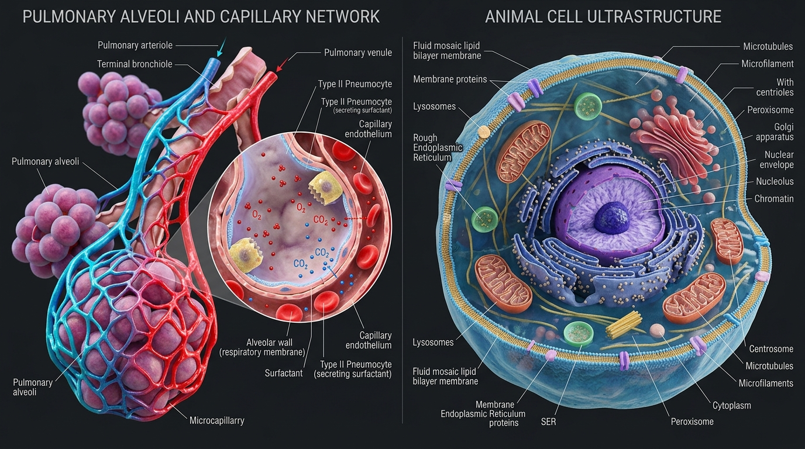

# 심장·폐포·동물세포 실사 3D 모델링 설계도 및 Unity 구현 레퍼런스

혈액 순환 및 산소 교환 시뮬레이션 제작을 위해 **1) 심장 내부 구조(심방·심실·판막)**, **2) 폐포와 모세혈관(기체 교환)**, **3) 동물 세포(세포 호흡)**를 실사 수준으로 3D 모델링하고 **Unity**에서 구현하기 위한 시각 도안, 해부학적 치수 명세, 오픈소스 3D 에셋 목록 및 Unity 아키텍처 문서입니다.

---

## 1. 시각적 3D 설계 도안 (Blueprint Reference)

- **심장 내부 단면 및 3D CAD 와이어프레임 설계 도안**: `docs/blueprints/heart_3d_blueprint.jpg`
- **폐포 기체 교환 및 동물 세포 단면 3D 모델링 도안**: `docs/blueprints/alveoli_and_cell_3d_blueprint.jpg`




---

## 2. 파트 1: 심장 (Heart) 3D 모델링 핵심 디테일 명세

실사 같은 심장 단면과 박동/혈류 시뮬레이션을 구현하려면 **좌·우 심실 벽 두께의 비대칭성**과 **4개 판막 및 건삭(힘줄)의 기하학적 작동 구조**가 가장 중요합니다.

### 2.1 심방·심실 (Chambers) 비율 및 내부 질감 설계

| 구조 | 실제 두께 / 치수 비율 | 내부 형태 및 모델링 포인트 (Topology & Sculpting) |
| :--- | :--- | :--- |
| **우심방 (Right Atrium)** | 벽 두께 약 `2 mm` | 상대적으로 매끄러운 내벽 + 빗살근(Pectinate muscles)의 잔잔한 융기. 상대정맥(위)과 하대정맥(아래)이 수직에 가깝게 연결됨. |
| **좌심방 (Left Atrium)** | 벽 두께 약 `3 mm` | 심장의 뒤쪽 상단에 위치. 좌·우 폐정맥 총 4개의 구멍이 뒤쪽 벽으로 직접 연결됨. |
| **우심실 (Right Ventricle)** | 벽 두께 약 `3 ~ 5 mm` | 횡단면(Cross-section)으로 잘랐을 때 **초승달(Crescent) 모양**으로 좌심실을 감싸안는 형태. 내벽에 그물망 같은 육주(Trabeculae carneae) 조각 필요. |
| **좌심실 (Left Ventricle)** | 벽 두께 약 **`10 ~ 15 mm`** (우심실의 **3배**) | 횡단면이 **두꺼운 원형/원뿔형**. 온몸으로 혈액을 뿜어내야 하므로 심근(Myocardium) 두께 차이가 한눈에 보여야 실사감이 살아남. |
| **심실중격 (Septum)** | 두께 약 `10 ~ 12 mm` | 좌심실과 우심실을 완벽히 분리하는 두꺼운 근육 벽 (상단 일부는 얇은 막성 중격). |

- **실사 디테일의 핵심 — 심실 내부 근육 기둥**: 심실 안쪽 벽은 매끈한 파이프가 아니라 스펀지/뿌리처럼 얽힌 **육주(Trabeculae carneae)**와 원뿔 모양으로 솟아오른 **유두근(Papillary muscles)**이 있어야 사실적입니다.

### 2.2 4대 판막 (Valves) 3D 구조 및 애니메이션 설계도

심장에는 **방실판막(2개)**과 **반월판막(2개)**이 있으며, 두 종류의 생김새와 열리는 메커니즘이 완전히 다릅니다.

- **혈류 및 판막 통과 순서**:
  `대정맥(Vena Cava)` → `우심방(Right Atrium)` → **[삼첨판(Tricuspid Valve)]** → `우심실(Right Ventricle)` → **[폐동맥판(Pulmonary Valve)]** → `폐동맥(Pulmonary Artery)` → `폐포 모세혈관망(산소 유입 / 이산화탄소 배출)` → `폐정맥(Pulmonary Veins, 4개)` → `좌심방(Left Atrium)` → **[이첨판/승모판(Mitral Valve)]** → `좌심실(Left Ventricle)` → **[대동맥판(Aortic Valve)]** → `대동맥(Aorta)` → `온몸 조직 모세혈관 및 동물 세포`

1. **방실판막 (심방 → 심실 사이): 낙하산 구조**
   - **삼첨판 (Tricuspid Valve, 우심방-우심실)**: **3개의 얇은 잎(Cusp/Leaflet)**으로 구성.
   - **이첨판 / 승모판 (Mitral / Bicuspid Valve, 좌심방-좌심실)**: **2개의 잎(전엽·후엽)**으로 구성.
   - **필수 연결 구조 — 건삭(Chordae tendineae) & 유두근(Papillary muscle)**:
     - 판막 잎의 끝부분에서 하얀 힘줄 실(**건삭**)들이 뻗어 나와 심실 바닥의 근육 기둥(**유두근**)에 묶여 있습니다.
     - 심실이 수축할 때 판막이 심방 쪽으로 뒤집히지(역류하지) 않도록 낙하산 줄처럼 잡아당기는 역할을 합니다. (이 실들을 3D 커브/실린더로 구현하면 디테일이 비약적으로 상승합니다.)
2. **반월판막 (심실 → 동맥 사이): 3개의 주머니(포켓) 구조**
   - **폐동맥판 (Pulmonary Valve, 우심실→폐동맥)** & **대동맥판 (Aortic Valve, 좌심실→대동맥)**
   - 건삭(힘줄 줄)이 **없습니다**.
   - 제비집이나 셔츠 주머니처럼 생긴 **반달 모양 주머니(Cusp) 3개**가 120도 간격으로 맞닿아 있다가, 심실이 피를 밀어 올리면 벽 쪽으로 납작하게 열리고, 피가 역류하려 하면 주머니 안에 피가 고이면서 부풀어 올라 중앙이 꽉 닫힙니다.

### 2.3 혈관의 입체 교차 (X자 꼬임 배치)
- 정면에서 볼 때 **폐동맥(우심실 출발)**이 **앞쪽**에 위치하며 왼쪽 위로 올라가 Y자로 갈라집니다.
- **대동맥(좌심실 출발)**은 폐동맥 바로 **뒤쪽**에서 시작해 오른쪽 위로 솟아오른 뒤 지팡이 모양(**대동맥궁, Aortic Arch**)으로 휘어져 등 쪽으로 내려갑니다. 위쪽에 3개의 가지 혈관(팔머리동맥, 좌총경동맥, 좌쇄골하동맥)이 뻗어 나옵니다.

---

## 3. 파트 2: 산소 교환 폐포 (Pulmonary Alveoli) 3D 모델링 명세

폐동맥을 통해 온 혈액이 산소를 받아 선홍색으로 바뀌는 미시적 전환 공간입니다.

- **포도송이 구조 (Alveolar Sac)**: 세기관지(Respiratory bronchiole) 끝에 구형의 작은 주머니(폐포, 지름 약 `200 µm`) 15~30개가 포도송이처럼 뭉쳐 있는 형태로 모델링합니다.
- **단면 절개 (Cutaway)**: 전체 포도송이 중 전면 2~3개의 폐포만 반구 형태로 절개하여 내부의 빈 공기 공간(Alveolar cavity)이 보이게 만듭니다.
- **폐포 벽 세포 디테일**:
  - **1형 폐포세포 (Type I Pneumocyte)**: 폐포 표면의 95%를 덮는 아주 얇고 납작한 육각형 타일 모양의 상피세포 (기체 확산 경로).
  - **2형 폐포세포 (Type II Pneumocyte)**: 구석에 둥글게 돌출된 세포(계면활성제 분비).
- **그물망 모세혈관 (Capillary Network)**:
  - 폐포 외벽을 바구니처럼 촘촘하게 감싸는 파이프 그물망입니다.
  - **크기 비율**: 모세혈관의 내경(`7~8 µm`)은 **적혈구(양면이 오목한 원반형, 지름 `7.5 µm`)가 딱 한 줄로 겨우 지나갈 정도**로 좁게 모델링해야 현실적입니다.
  - **셰이더 그라데이션**: 입구(폐동맥 세동맥 측)의 검붉은/푸른 톤에서 출구(폐정맥 세정맥 측)의 밝은 선홍색으로 자연스럽게 Vertex Color 또는 UV Gradient가 변하도록 설계합니다.

---

## 4. 파트 3: 동물 세포 (Animal Cell) 3D 모델링 명세

온몸 순환(체순환)을 통해 조직 모세혈관에 도달한 산소와 영양소가 최종적으로 전달되어 **세포 호흡(에너지 생성)**이 일어나는 종착지입니다.

- **세포막 (Plasma Membrane)**: 비정형의 부드러운 구형/타원형에 `1/4` 부채꼴(Wedge) 단면을 잘라 내부를 노출합니다. 단면 가장자리에 **인지질 이중층(Phospholipid bilayer)**의 구슬 구조를 표현합니다.
- **핵 (Nucleus)**: 세포 중앙의 큰 구형. 겉면(핵막)에 구멍(**핵공, Nuclear pores**)이 뚫려 있고, 단면 중앙에 밀도가 높은 구형의 **핵소체(Nucleolus)**와 염색사를 배치합니다.
- **소포체 (Endoplasmic Reticulum - ER)**:
  - **거친면 소포체 (Rough ER)**: 핵막 바로 바깥에 연결된 납작하고 겹겹이 접힌 주머니 미로 구조 (표면에 리보솜 알갱이 분포).
  - **매끈면 소포체 (Smooth ER)**: 거친면 소포체 바깥쪽으로 이어지는 산호초 모양의 매끈한 관(Tube) 다발.
- **골지체 (Golgi Apparatus)**: 세포막 방향에 배치된 팬케이크처럼 휘어진 납작한 주머니 층(Cisternae)과 끝에서 떨어져 나오는 구형 소낭(Vesicle)들.
- **미토콘드리아 (Mitochondria) — [시뮬레이션 핵심 타깃]**:
  - 혈액이 운반해 온 **산소(O2)와 포도당을 받아 에너지(ATP)를 만들고 이산화탄소(CO2)를 내보내는 핵심 장소**입니다.
  - 강낭콩/소시지 모양의 외막 안쪽에 내막이 구불구불하게 주름진 **크리스테(Cristae)** 단면을 절개하여 보여줍니다.

---

## 5. 무료 오픈소스 3D 모델 다운로드 사이트

| 플랫폼 / 프로젝트명 | 특징 및 강점 | 검색 키워드 / 활용법 | 바로가기 링크 |
| :--- | :--- | :--- | :--- |
| **NIH 3D (미국 국립보건원)** | 실제 환자 CT/MRI 기반으로 추출한 의학적으로 정확한 무료 심장·혈관·세포 3D 모델 제공 (`.stl`, `.obj`, `.glb`). | `Heart anatomy`, `Heart valves`, `Alveoli`, `Eukaryotic cell` | https://nih3d.niaid.nih.gov/ |
| **Z-Anatomy (오픈소스 Blender 해부학)** | 일본 *BodyParts3D* 기반 완전 무료 오픈소스(CC BY-SA 4.0) 인체 3D 해부학 프로젝트. Blender 파일(`.blend`) 제공. | Cardiovascular(심혈관계) 컬렉션 활성화 후 FBX 익스포트 | https://www.z-anatomy.com/ / https://github.com/Z-Anatomy/Models-of-human-anatomy |
| **University of Dundee (CAHID) Sketchfab** | 영국 던디 대학교 해부학 연구소 공식 채널. 실제 해부 표본 3D 스캔 단면(판막, 건삭, 육주 디테일). | `Heart cross section`, `Chambers of the heart`, `Heart valves` | https://sketchfab.com/anatomy_dundee |
| **Allen Cell Explorer (Allen Institute)** | 실제 세포 현미경 3D 스캔 데이터셋 (미토콘드리아, 핵, 소포체, 골지체). | 3D Cell Viewer 데이터셋 | https://www.allencell.org/ |

---

## 6. Unity 엔진 실사 구현 및 시뮬레이션 설계 규격

### 6.1 렌더 파이프라인 및 셰이더 (`HDRP` 또는 `URP`)
- **`HDRP/Lit` (권장) 또는 커스텀 SSS 셰이더**:
  - **Subsurface Scattering (SSS)**: 심근(진한 붉은색 산란), 판막/건삭(아이보리색 반투명 산란), 세포막/폐포(반투명 산란) Diffusion Profile 적용.
  - **Wetness (젖은 표면)**: `Roughness 0.15 ~ 0.3` (또는 `Smoothness 0.7 ~ 0.85`), `Coat Mask 0.8` 이상으로 촉촉한 생체 조직 광택 표현.

### 6.2 프리팹 계층 구조 (Prefab Hierarchy) & BlendShapes
```text
Heart_Root (Prefab)
 ├── Heart_Exterior_Mesh (외벽 + 관상동맥, SkinnedMeshRenderer)
 ├── Heart_CrossSection_Mesh (전면 단면 절개 메쉬 - 좌/우심실 두께 비대칭 및 육주 포함)
 │    └── BlendShapes: [0] Atrial_Systole (0~100), [1] Ventricular_Systole (0~100)
 ├── Valves_Group
 │    ├── Tricuspid_Valve (삼첨판 3엽 + 건삭) -> BlendShape: [0] Open (0~100)
 │    ├── Pulmonary_Valve (폐동맥판 3포켓)   -> BlendShape: [0] Open (0~100)
 │    ├── Mitral_Valve (이첨판 2엽 + 건삭)    -> BlendShape: [0] Open (0~100)
 │    └── Aortic_Valve (대동맥판 3포켓)       -> BlendShape: [0] Open (0~100)
 └── BloodFlow_Splines (Unity Splines 컨테이너)
      ├── RightHeart_To_Lungs_Spline (대정맥 -> 우심방 -> 삼첨판 -> 우심실 -> 폐동맥 -> 폐포)
      └── Lungs_To_LeftHeart_To_Cell_Spline (폐포 -> 폐정맥 -> 좌심방 -> 이첨판 -> 좌심실 -> 대동맥 -> 동물세포)
```

### 6.3 심장 박동 주기 (Cardiac Cycle) 동기화 테이블 (`t = 0.0 ~ 1.0`, 기본 75 BPM = 0.8초 주기)

| 박동 단계 (Phase) | 정규화 시간 (`t`) | 심방 수축 가중치 | 심실 수축 가중치 | 방실판막 (삼첨판·이첨판) Open | 반월판막 (폐동맥판·대동맥판) Open | 혈류 속도 배율 |
| :--- | :--- | :--- | :--- | :--- | :--- | :--- |
| **1. 심방 수축기 (Atrial Systole)** | `0.00 ~ 0.15` | `0 -> 100 -> 0` | `0` | **`100` (완전 열림)** | **`0` (닫힘)** | `1.2x` (심실 유입 가속) |
| **2. 심실 수축기 (Ventricular Systole)** | `0.15 ~ 0.45` | `0` | `0 -> 100` | **`0` (꽉 닫힘 + 건삭 팽팽)** | **`100` (완전 열림)** | **`3.0x` (동맥 분출 맥동)** |
| **3. 심실 이완기 (Diastole)** | `0.45 ~ 1.00` | `0` | `100 -> 0` | **`60` (자연 유입 열림)** | **`0` (꽉 닫힘 - 역류 방지)** | `0.6x` (완만한 순환) |

### 6.4 폐포 및 동물세포 산소 교환 시뮬레이션 로직
1. **폐포 (Alveoli Gas Exchange)**:
   - 적혈구(RBC) 파티클/인스턴스가 폐포 모세혈관 스플라인 구간(`s = 0.0 ~ 1.0`)을 통과할 때 색상을 `Color.Lerp(DeoxygenatedColor(#4A0E17), OxygenatedColor(#E61919), s)`로 보간합니다.
   - 동시에 폐포 내부에서 산소(`O2`, 하늘색/흰색 발광 구체) 파티클이 모세혈관 내 적혈구로 이동해 흡수되고, 적혈구에서 이산화탄소(`CO2`, 보라색/회청색 구체) 파티클이 폐포 공간으로 방출됩니다.
2. **동물 세포 (Cellular Respiration in Mitochondria)**:
   - 동맥혈을 타고 동물 세포 주변 모세혈관에 도달한 선홍색 적혈구에서 `O2` 파티클이 분리되어 세포막(인지질 이중층)을 투과한 뒤 **미토콘드리아(Mitochondria) 크리스테** 내부로 진입합니다.
   - `O2`가 미토콘드리아에 도달할 때마다 **ATP 에너지 생성 발광(Emission Pulse)** 이펙트가 발생하고, 생성된 `CO2` 파티클이 다시 모세혈관으로 배출되면서 적혈구 색상이 다시 암적색(`#4A0E17`)으로 변해 우심방으로 귀환합니다.

